# Meanvon

Meanvon is a lightweight AI toolbox that supports basic AI applications such as **text, image, video, and audio**. All you need is a regular laptop or desktop computer to run the functional components freely.

> Reconstruction based on 📚 stable-diffusion-webui & 📚 Fooocus.

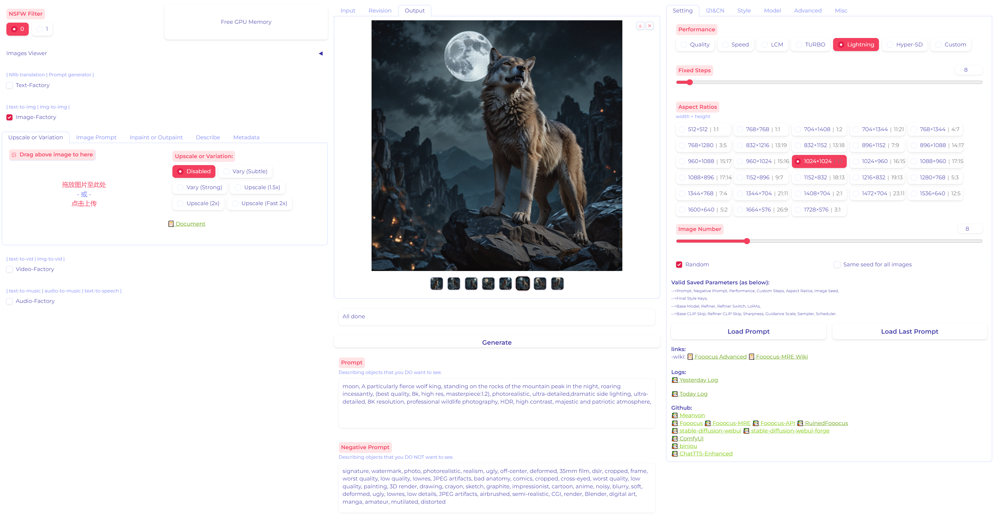

## Table of Contents

- [Updates / Changelog](#updates--changelog)
- [Features](#features)
- [Prerequisites](#prerequisites)
- [Installation](#installation)
- [CUDA Support](#cuda-support)
- [Usage](#usage)
- [Credits](#credits)
- [Thanks](#thanks)
- [Bug Fix / Troubleshooting](#bug-fix--troubleshooting)

---

## Updates / Changelog

### 🆕 2026-09-8
- 🔥 **Support Zimage, MiniMax, Krea2, QwenImage** — new model introduced by alibaba/Comyfui/minimax ...

### 🆕 2024-09-14
- 🔥 **Support HunyuanDiT1** — new model introduced by Tencent.

### 🆕 2024-08-04
- 🔥 **Support Flux** — new model introduced by Black Forest Lab.

### 🆕 2024-07-09
- 🔥 **Fix ControlNet not being called in some cases** — Face swap / CPDS.

### 🆕 2024-07-04
- 🔥 **Support ChatTTS** (2noise/ChatTTS) — supports both Chinese and English. Trained on approximately 100,000 hours of Chinese and English data, ChatTTS delivers high quality and naturalness in speech synthesis.
- 🔥 **Support the latest features of ComfyUI** — SD3 / Hyper-SD.
- 🔥 **Support LLaMA-3 ChatRobot** — Meta-Llama-3-8B-Instruct-GGUF / Llama3-8B-Chinese-Chat.q6_k.

### 🆕 2024-04-01
- 🔥 **Support API Server** — API calls are supported, covering the basic operations of T2I (text-to-image) and I2I (image-to-image) functions.

### 🆕 2024-03-07
- 🆕 Initial version.

---

## Features

### Core Features

- **Text generation**
  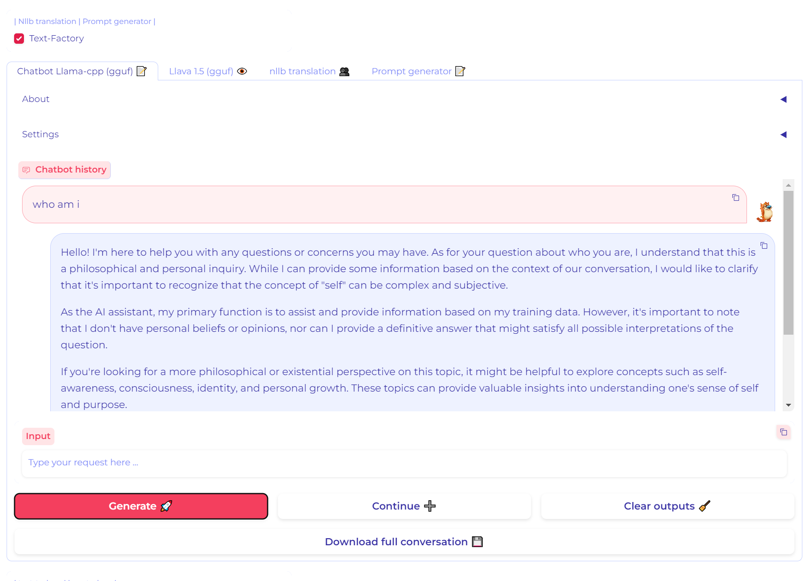

- **Image generation and modification**
  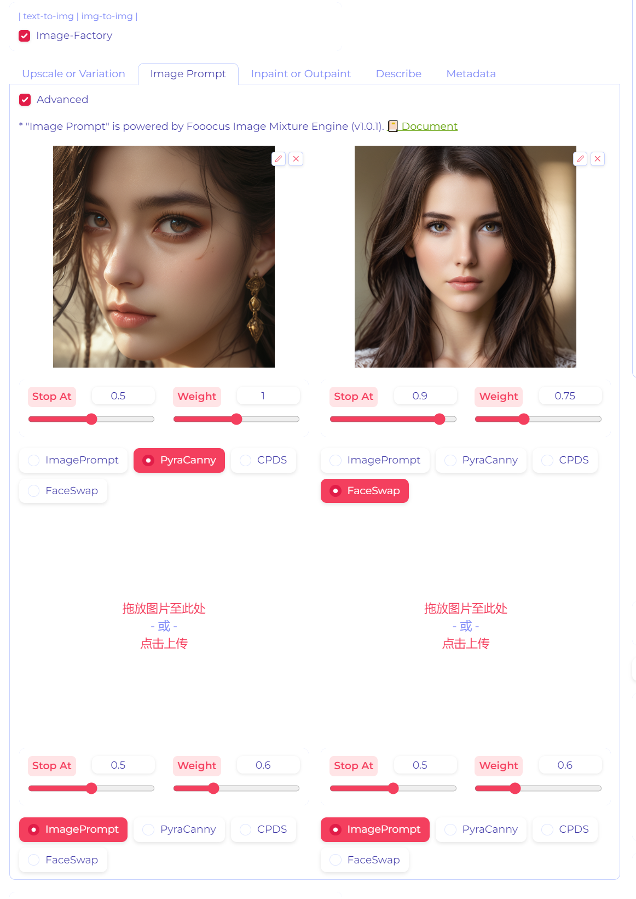

- **Audio generation**
  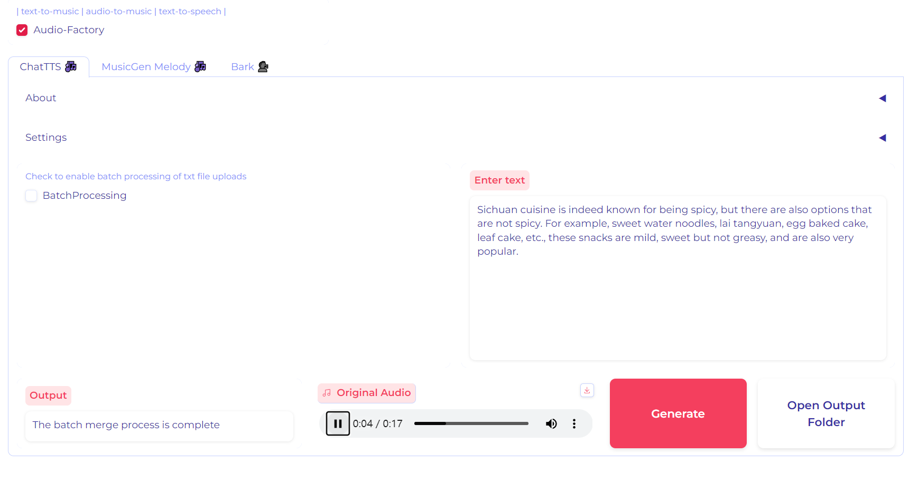

- **Video generation and modification**
  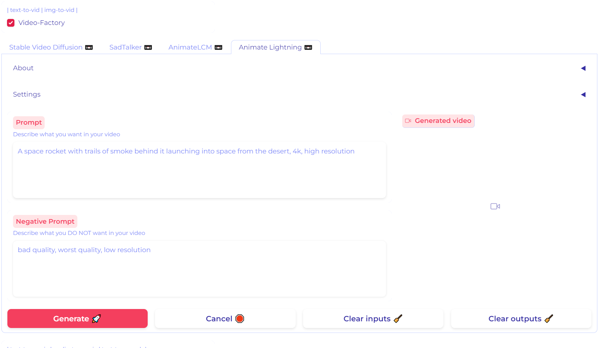

### Other Features

- **Cross-platform** : GNU/Linux, Windows 10/11.
- **Model support** : Stable Diffusion SD-1.5, SDXL, SDXL-Turbo, LCM, Lightning, Hyper-SD, playground_v25, Flux, HunyuanDiT1 — through the built-in model list or standalone `.safetensors` files.
  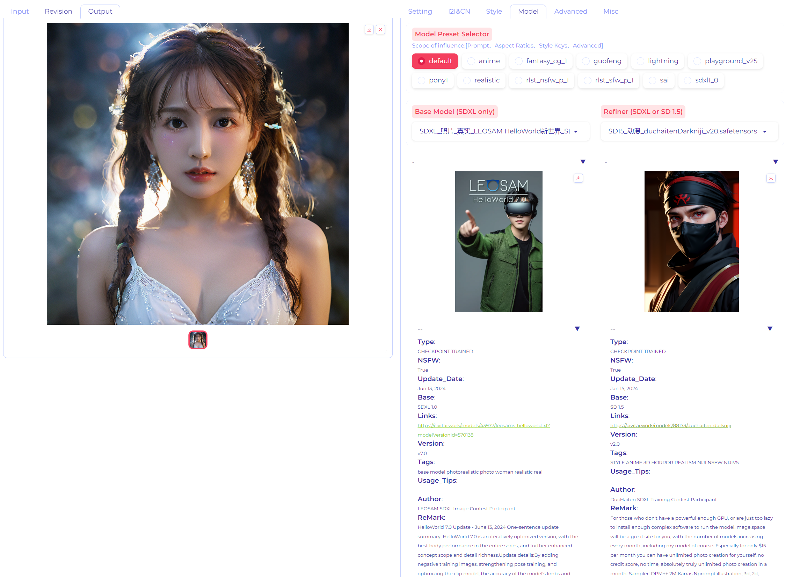

- **Checkpoints & LoRA support** : SDXL & LoRAs.
  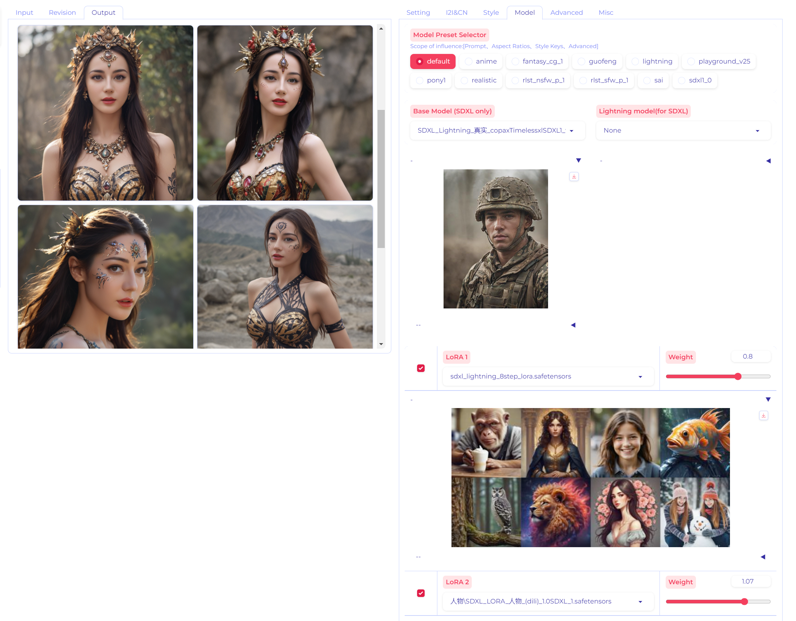

- **Customizable styles** through a user-friendly configuration editor.
  - Settings
    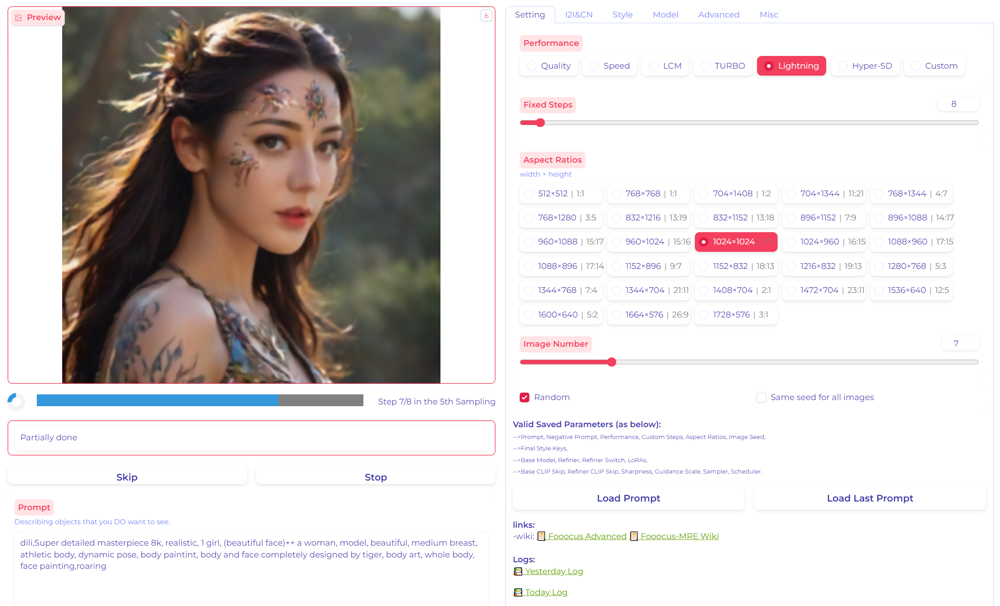
  - Advanced
    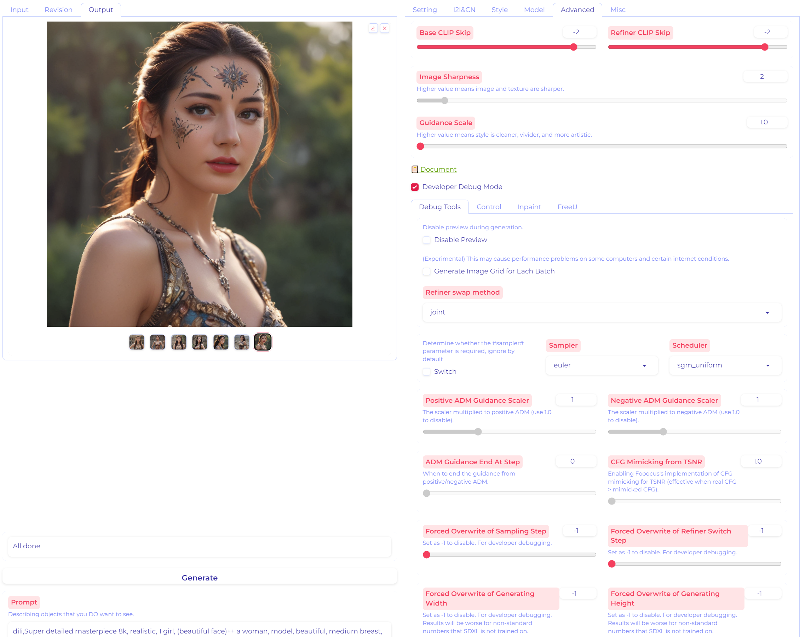

- **Style switching between models**, allowing users to add extra GPTv2 prompts.
  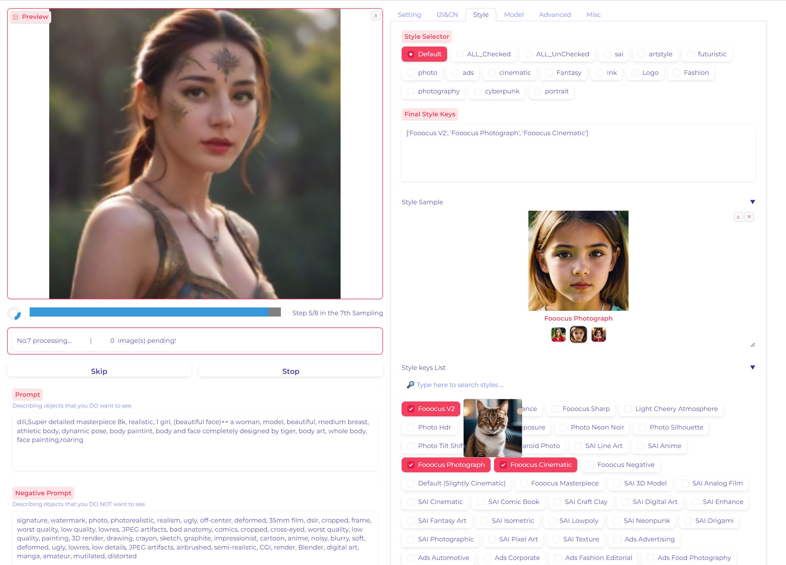

- **Face swap** : replace a specific face with the original face.
  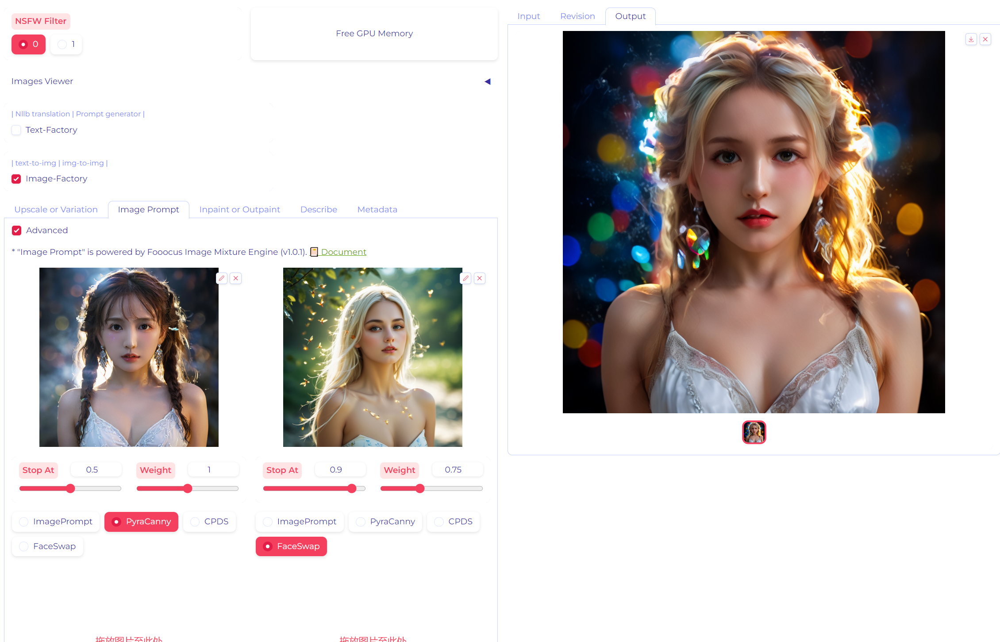

---

## Prerequisites

### Minimal Hardware

| Item | Requirement |
|------|-------------|
| CPU  | 64-bit processor |
| RAM  | 8 GB |
| Storage | GNU/Linux : at least 20 GB without models |
|          | Windows : at least 30 GB without models |
|          | macOS : at least ?? GB without models |
| Storage type | HDD |

### Supported Operating Systems

- Ubuntu 22.04.3
- Linux Mint 21.2
- Windows 10 22H2
- Windows 11 22H2

---

## Installation

### Windows 10 / Windows 11

Windows installation has more prerequisites than GNU/Linux, and requires the following software (which will be installed automatically) :

- Git
- Python
- OpenSSL
- Visual Studio Build Tools
- Windows 10/11 SDK
- ffmpeg

---

## CUDA Support

Install the PyTorch version that matches your NVIDIA GPU driver version:

```bash
pip install torch torchvision torchaudio xformers --index-url https://download.pytorch.org/whl/cu118
```

Or pin a specific version:

```bash
pip install torch==2.2.0 torchvision==0.17.0 torchaudio==2.2.0 xformers --index-url https://download.pytorch.org/whl/cu118
pip install torch==2.1.2 torchvision==0.16.2 torchaudio==2.1.2 xformers --index-url https://download.pytorch.org/whl/cu118
pip install torch==2.1.1 torchvision==0.16.1 torchaudio==2.1.1 xformers --index-url https://download.pytorch.org/whl/cu118
pip install torch==2.1.0 torchvision==0.16.0 torchaudio==2.1.0 xformers --index-url https://download.pytorch.org/whl/cu118
pip install torch==2.0.1 torchvision==0.15.2 torchaudio==2.0.2 xformers --index-url https://download.pytorch.org/whl/cu118
```

---

## Usage

**API server**

```bash
python api_server.py
```

**WebUI**

```bash
python webui_server.py
```

---

## Credits

This application uses the following software and technologies:

- 🤗 **Hugging Face** : Diffusers and Transformers libraries, and almost all the generative models.
- **Gradio** : webUI.
- **llama-cpp-python** : Python bindings for llama-cpp.
- **LLaVA**
- **NLLB translation** : language translation.
- **Stable Diffusion** : txt2img, img2img, Image variation, inpaint, ControlNet, Text2Video-Zero, img2vid.
- **InsightFace** : face swapping.
- **Real-ESRGAN** : upscaler.
- **GFPGAN** : face restoration.
- **MusicGen Melody**
- **MusicLDM**
- **Bark** : text-to-speech.
- **ChatTTS** : text-to-speech.
- **AnimateLCM** : txt2vid.

---

## Thanks

1. 📚 Fooocus
2. 📚 Fooocus-MRE
3. 📚 Fooocus-API
4. 📚 RuinedFooocus
5. 📚 stable-diffusion-webui
6. 📚 stable-diffusion-webui-forge
7. 📚 ComfyUI
8. 📚 biniou

---

## Bug Fix / Troubleshooting

### fix 1

**Description:** `ModuleNotFoundError: No module named 'torchvision.transforms.functional_tensor'`

`from torchvision.transforms._functional_tensor import rgb_to_grayscale` was moved/renamed. Update the imports accordingly:

```python
from scipy import special
from scipy.stats import multivariate_normal
from torchvision.transforms._functional_tensor import rgb_to_grayscale
```

### fix 2

**Description:** When using xformers cross-attention:

```
X:\python_project\Meanvon\venv\lib\site-packages\diffusers\utils\outputs.py:63: UserWarning:
torch.utils._pytree._register_pytree_node is deprecated.
Please use torch.utils._pytree.register_pytree_node instead.
torch.utils._pytree._register_pytree_node(
```

This is only a deprecation warning. Switch the call to the new API shown above to silence it.

### fix 3

**Description:** `A matching Triton is not available, some optimizations will not be enabled. Error caught was: No module named 'triton'`

Download the two files:

- triton: https://huggingface.co/r4ziel/xformers_pre_built/resolve/main/triton-2.0.0-cp310-cp310-win_amd64.whl
- cmake: https://pypi.org/project/cmake/#files

Then install:

```bash
pip install https://huggingface.co/r4ziel/xformers_pre_built/resolve/main/triton-2.0.0-cp310-cp310-win_amd64.whl
python -m pip install cmake-3.29.0.1-py3-none-win_amd64.whl
```

### fix 4

**Description:** GFPGAN model path issue with SadTalker.

**File:** `extensions\sadtalker\src\utils\face_enhancer.py`

Look for the `else` block where `bg_upsampler = None` is set, then apply the fix:

```python
    else:
        bg_upsampler = None

    # fix: look for the GFPGAN weights in the correct local path
    gfpgan_path = os.path.join(os.getcwd(), "models/gfpgan/weights")
    print(gfpgan_path)
    model_path = os.path.join(gfpgan_path, model_name + '.pth')
    print(model_path)

    if not os.path.isfile(model_path):
        model_path = os.path.join('models/checkpoints', model_name + '.pth')
```

**File:** `venv\Lib\site-packages\gfpgan\utils.py`

```python
        self.face_helper = FaceRestoreHelper(
            upscale,
            face_size=512,
            crop_ratio=(1, 1),
            det_model='retinaface_resnet50',
            save_ext='png',
            use_parse=True,
            device=self.device,
            model_rootpath='models/gfpgan/weights')   # fix

        if model_path.startswith('https://'):
            model_path = load_file_from_url(
```